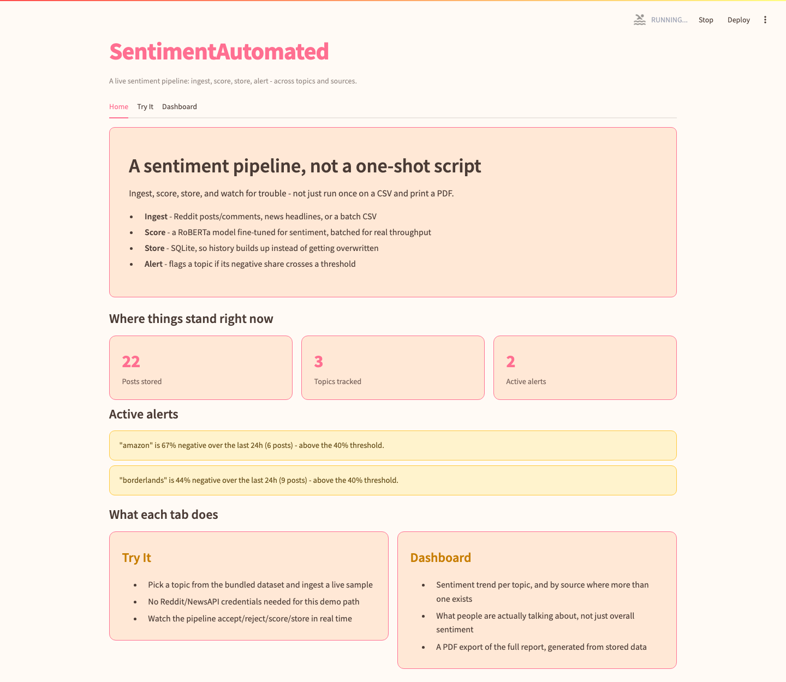
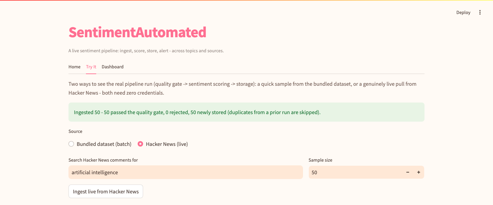
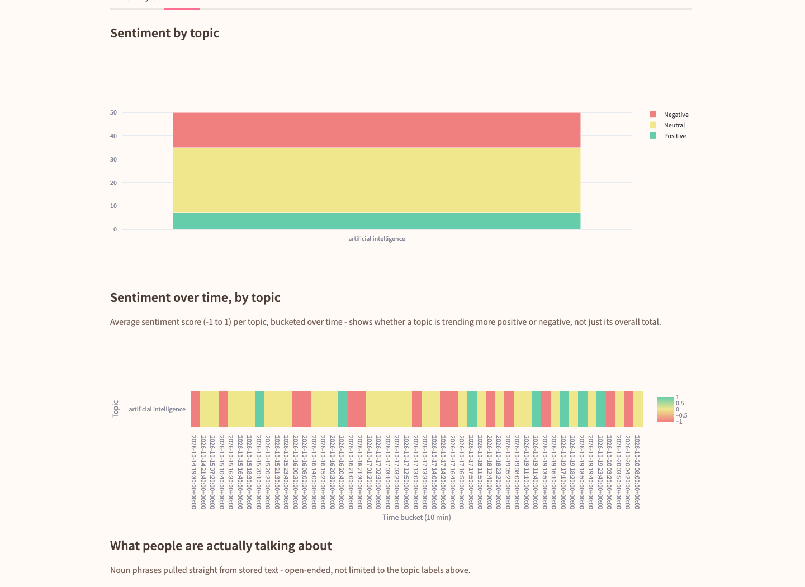

# SentimentAutomated

A live sentiment-monitoring pipeline - ingest, score, store, alert - not a one-shot "CSV in, PDF
out" script. Built around the same RoBERTa model the original project used, reshaped into
something that actually runs continuously instead of once per manual invocation.

## Why this exists

The original version of this project worked (score a CSV, print a PDF), but it wasn't a
pipeline - no storage, no live data, no concept of "this topic is trending negative right now."
This rework keeps the model and the core idea, and builds the actual infrastructure around it:
a quality gate, a real datastore, topic tagging, multi-source ingestion, and threshold-based
alerting.

## Screenshots

**Home** - real stats and live alerts pulled straight from the SQLite store:



**Try It, live** - a genuinely live pull from Hacker News, no credentials needed, run end to end
through the real pipeline:



**Dashboard** - sentiment by topic, a sentiment-over-time heatmap per topic, a correlation view
showing whether two topics' sentiment trends move together, open-ended noun-phrase extraction
(what people are actually saying, not just the fixed topic labels), what the quality gate
rejected and why, and a PDF export - shown here with real data from the live Hacker News pull
above, spanning real comment timestamps from the last several days:



## How it works

```
ingest (Hacker News / Reddit / NewsAPI / batch CSV)
   -> quality gate (dedupe, reject empty/non-English, truncate)
   -> sentiment scoring (RoBERTa, batched)
   -> topic tagging
   -> SQLite store
   -> dashboard + alerts
```

**Ingest** (`hn_ingest.py`, `ingest.py`, `news.py`) - **Hacker News is the default live source**
(`hn_ingest.py`, via Algolia's public HN search API - no key, no registration, no approval, works
immediately). Reddit ingestion (`ingest.py`, via `praw`) is still supported for anyone with API
access, but isn't the default anymore - Reddit's app registration moved to a manual-approval
process partway through this project's build (previously instant self-serve; confirmed directly
by trying it), so a source that actually works out of the box took priority. NewsAPI (`news.py`)
remains available as a third option. The original static `twitter_training.csv` isn't deleted -
it's kept as a "batch mode" input, and both it and the live HN path power the **Try It** tab.

**Quality gate** (`quality.py`) - dedupes by post ID, rejects empty/near-empty text, rejects
non-English text (`langdetect`), truncates long text instead of erroring. Every rejection is
logged with a reason, not silently dropped - the same validate/reject-and-log pattern used in the
data-infra-learn flagship project.

**Scoring** (`process.py`) - `cardiffnlp/twitter-roberta-base-sentiment`, run in real batches
through the tokenizer rather than one row at a time (the original two scripts' loop defeated the
point of GPU acceleration entirely).

**Topic tagging** (`topics.py`) - a fixed keyword match for live ingestion (you already know
what you're tracking), or spaCy noun-chunk extraction for exploring what a batch of text is
actually about with no predefined topic list.

**Storage** (`store.py`) - SQLite, append-only. Running ingestion again just adds new posts;
re-ingesting the same post is a no-op, not a duplicate row.

**Alerting** (`alerts.py`) - if a topic's negative-sentiment share crosses a threshold within a
rolling window, it surfaces as an active alert on the dashboard.

## A real validation finding

The CSV this project ships with (`twitter_training.csv`) happens to include its own human-labeled
ground truth. Scoring 1,000 random rows and comparing against that ground truth (excluding the
dataset's "Irrelevant" label, which isn't in the model's 3-class output space):

**62.8% agreement with human labels**, on 831 comparable rows.

That's a real, useful number: `cardiffnlp/twitter-roberta-base-sentiment` was trained on general
Twitter data, not gaming/tech-entity tweets specifically, so a meaningful chunk of disagreement
with ground truth here is expected, not a bug. It's reported honestly rather than assumed away.

## What the quality gate actually caught

Running the gate on real samples of the bundled dataset: **most rejections were duplicate post
IDs**, not junk text - this specific Kaggle dataset includes multiple paraphrased variants of the
same tweet sharing one Tweet ID (a side effect of how the dataset was built for data
augmentation). The dedup logic catches this correctly; on a random cross-section it was closer to
even between duplicates, non-English text, and empty/near-empty text.

## Setup

```bash
python3 -m venv .venv
source .venv/bin/activate
pip install -r requirements.txt
python3 -m spacy download en_core_web_sm
```

**For Reddit/NewsAPI ingestion** (optional - Hacker News and the bundled dataset both work with
zero setup):

```bash
cp .env.example .env
# fill in REDDIT_CLIENT_ID / REDDIT_CLIENT_SECRET if you have Reddit API access
# (reddit.com/prefs/apps - now a manual-approval process, no longer instant)
# and optionally NEWSAPI_KEY (free at newsapi.org/register)
```

## Run it

**Dashboard (recommended):**

```bash
streamlit run app.py
```

No credentials needed - the **Try It** tab can ingest either a sample from the bundled dataset or
a genuinely live pull from Hacker News, both through the real pipeline.

**Live Hacker News ingestion (no credentials needed):**

```bash
python3 hn_ingest.py "<search query>"                                    # one-off pull
python3 scheduler.py "<search query>" <topic> [interval_seconds]          # runs continuously
```

**Live Reddit ingestion (needs `.env` credentials and approved API access):**

```bash
python3 ingest.py <subreddit> [limit]                                         # one-off pull
python3 scheduler.py <subreddit> <topic> [interval_seconds] reddit             # runs continuously
```

**Score a CSV directly (the original script's interface, still available):**

```bash
python3 process.py
```

**Run the tests:**

```bash
pytest tests/
```

## Project structure

```
hn_ingest.py    # Hacker News ingestion (default live source, no credentials needed)
ingest.py        # Reddit ingestion (needs approved API access) + batch-CSV loader
news.py           # NewsAPI ingestion (optional third source)
quality.py        # data quality gate (dedupe/reject/truncate), logs every rejection
process.py         # sentiment scoring (batched), replaces sentiment.py + sentiment_limited.py
topics.py           # keyword tagging + spaCy noun-chunk extraction
store.py             # SQLite storage
alerts.py             # threshold-based negative-sentiment alerting
pipeline.py            # ties ingest -> quality -> score -> tag -> store together
scheduler.py             # runs the pipeline on an interval
report.py                 # the original PDF report, now reading from the store (optional export)
app.py                     # Streamlit dashboard (Home / Try It / Dashboard)
twitter_training.csv        # bundled dataset - batch-mode input + Try It tab's demo data
tests/                        # pytest coverage for quality/store/alerts/topics
```

## Limitations

- Reddit's API moved to a manual-approval registration process partway through this project's
  build (previously instant); that path is kept and documented but isn't runnable on demand the
  way Hacker News is - a real external constraint, not a design choice
- NewsAPI ingestion needs the user's own free API key - not runnable without it
- Topic tagging is a fixed keyword match or noun chunks, not real aspect-based sentiment analysis
- The 62.8% ground-truth agreement reflects a domain mismatch (general Twitter vs. gaming/tech
  entities), not a flaw in the pipeline itself - a domain-specific fine-tune would likely do
  better, but that's out of scope here
- The scheduler is a straightforward interval loop, not Kafka/Airflow-scale orchestration - a
  deliberate choice, not an oversight, for a project at this scale

## What I'd improve with more time

- A real scheduled deployment (even a cheap always-on box) instead of running the scheduler
  manually
- Fine-tuning the sentiment model on a small labeled sample from the actual tracked topics, to
  close some of the domain-mismatch gap found above
- A proper aspect-based sentiment pass per topic, instead of one overall sentiment per post
